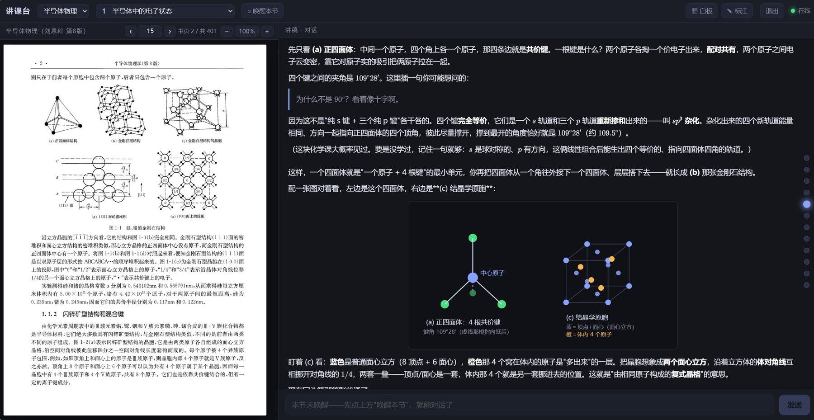

# forgotten-inkstone · 讲课台

一个**拿课本逐页讲课**的本地网页讲台。

左边摊开你的课本 PDF，右边坐着一个 AI 分身——默认叫「白砚」——一句句陪你把课本过下去。它会停到该讲的那页、画曲线、开白板让你当堂演算，也会在讲完一个概念后停下来问你「清楚吗」。不是看录播，是两个人在一本书上推。



由 **白咲** 搭建。

> 名字来由：砚是研墨写字的那块石头。讲一门课，说到底是把字一遍遍磨进去的活。

> **本仓库不含任何教材 PDF 与讲稿**——那些留在你自己机器上，别提交进来。

---

## 长什么样

- **左栏**：课本 PDF，分身说到哪页就自动停到哪页，也能自己翻。
- **右栏**：分身的「讲稿流」——像上课一样一段段冒出来；你随时插话、作答、反问，都进它的收件箱。
- **白板**：讲到题，分身申请开一块板，你在板上手写演算；一句「读给白砚」，板和你写的字会合成一张图回传给它。
- **公式与图**：讲稿 markdown 里的 `$...$` / `$$...$$` 用 KaTeX 真渲染；曲线、波形可以直接内联一段 `<svg>` 就地画出来。
- **口令与监听**：默认**只监听本机** `127.0.0.1`（本机免口令直接进）。要对外得显式设 `TEACH_HOST=0.0.0.0`，且**必须先设 `TEACH_PASS`**——否则直接拒绝启动，免得 clone 下来就成一台对外弱口令服务。

## 跑起来

依赖：**Python 3**（纯标准库，无 pip 依赖，见 `requirements.txt`）；把 PDF 页渲成图、抽文字层用到 **poppler**（`pdftoppm` / `pdftotext`）；讲义分身是一个**说 ACP 的 agent**，由 `TEACH_AGENT_BIN` 指定（见「接一个 ACP 分身」）。跑测试：`python3 -m unittest discover -s tests`。

```bash
# 1) 放课本：把 PDF 丢进一个目录，用 TEACH_BOOKS 指过去
export TEACH_BOOKS=/path/to/books

# 2) 起网页服务
TEACH_PASS=你的口令 python3 server.py      # 默认端口 8000

# 3) 另开一个终端，起分身驱动器（先装好 ACP agent，见「接一个 ACP 分身」）
TEACH_AGENT_BIN=claude-code-acp python3 driver.py
```

浏览器打开 `http://127.0.0.1:8000`。选课程、选章节、点「唤醒本节」，驱动器就会拉起这一章的分身开讲。

## 配你的课（三张表）

`server.py` 顶部有三张示例表，换成你的课本即可：

- **VOLUMES** —— 一份 PDF 一卷：文件名、总页数、`offset`（书页 = PDF页 − offset，用来对齐「书上的页码」和「PDF 的页码」）。
- **COURSES** —— 一门课用哪几卷。
- **CHAPTERS** —— 每章 `{id, title, vol, page}`，`page` 是该章起始的 **PDF** 页。

表里预置的两门课（半导体物理、信号与系统）只是演示，直接删掉换成自己的。

## 环境变量

| 变量 | 说明 | 默认 |
|---|---|---|
| `TEACH_PASS` | 访问口令 | `changeme`（对外时**必须先改**，否则拒绝启动） |
| `TEACH_HOST` | 监听地址 | `127.0.0.1`（对外要显式设 `0.0.0.0`） |
| `TEACH_PORT` | 网页端口 | `8000` |
| `TEACH_BOOKS` | 课本 PDF 目录 | `/path/to/books` |
| `TEACH_QUEUE` | 开讲请求队列文件 | 仓库内 `teach-queue.json` |
| `TEACH_PROMPT` | 分身人设提示词 | `prompts/白砚.md` |
| `TEACH_BASE` | 驱动器找网页服务的地址 | `http://127.0.0.1:8000` |
| `TEACH_AGENT_BIN` | 起分身的可执行（**只放程序**：PATH 上的名字或绝对路径）；得是**说 ACP 的 agent**，不是任意 CLI | **必填** |
| `TEACH_AGENT_ARGS` | 程序之后的全部 flag；支持 3 个占位符，默认空串（一个 flag 都不传） | 空 |
| `TEACH_AGENT_SYSTEM_PROMPT` | 人格走哪条通道：`meta` / `meta_append` / `args` / `both` / `none` | `meta` |
| `TEACH_AGENT_PERMISSION` | 分身请求工具权限时怎么答：`allow` / `deny` / `cancel` | `allow` |
| `TEACH_AGENT_LOG_UPDATES` | `1` = 把分身的流式说话也打进日志（默认只记工具调用） | `0` |
| `TEACH_AGENT_PROTOCOL` | ACP 协议版本；这一版只实现了 `1` | `1` |
| `TEACH_DRY` | `1` = 空跑：不 spawn，只把命令、人格通道、三帧 JSON 打进日志 | `0` |
| `TEACH_POLL` | 驱动器扫 live / 收件箱的间隔（秒） | `2` |

## 接一个 ACP 分身

分身（默认人设叫「白砚」）是一个**说 ACP 的常驻子进程**。ACP（Agent Client Protocol）就是 **stdio 上的 JSON-RPC 2.0**：一行一帧、UTF-8；本实现走 **v1**。讲台这边当 client，agent 那边当 server——`driver.py` 负责起停它、跟它握手、把学生的话喂进去。

先装一个 ACP agent，再用 `TEACH_AGENT_BIN` 指过去（**必填**，只放程序本身）：

```bat
set TEACH_AGENT_BIN=claude-code-acp                                 :: npm i -g @zed-industries/claude-code-acp（读 _meta.systemPrompt）
set TEACH_AGENT_BIN=opencode & set TEACH_AGENT_ARGS=acp             :: 本机已有 opencode
set TEACH_AGENT_BIN=C:\path\to\my-acp-agent.exe                    :: 自研 agent
```

`TEACH_AGENT_ARGS` 是**程序之后**的全部 flag，按空白切成 argv；默认空串（一个 flag 都不传）——多数 ACP agent 不需要额外参数。里面可以放三个占位符：

| 占位符 | 展开为 |
|---|---|
| `{prompt}` | `prompts/白砚.md` 的内容，作为**单个** argv token（带换行、带空格也整块传，不再切） |
| `{prompt_file}` | 该文件的绝对路径（给「路径存在就读文件、否则当文本」的 CLI 用） |
| `{session}` | 已经知道的会话 id；没有则空串 |

其余 `{xxx}` 原样传给 agent（启动时告警一次）。`{prompt}` / `{prompt_file}` 只在人格走 `args` / `both` 通道时才有内容，见下一节。

**分词规则**：按空白切分；成对的 `"` 把含空格的片段括成一项且引号本身去掉；反斜杠**不作转义**（Windows 路径 `C:\Users\...` 不会被吃掉）；引号不配对 → 启动即报错退出。不采用 JSON 数组格式，因为 cmd.exe 里引号转义太痛苦。

配置错误（`TEACH_AGENT_BIN` 没设或含空白、PATH 上找不到、引号不配对、通道 / 权限取值非法、协议版本不是 1）会在启动时打中文报错并以 **exit code 2** 退出，不进主循环。`TEACH_DRY=1 TEACH_AGENT_BIN=x python3 driver.py` 会把「会执行什么命令、人格走哪条通道、将要发的三帧 JSON、第一句交代全文」都打进日志——**不装任何 agent 也能校验配置**。

环境变量在驱动启动时读一次，**运行中改了不生效，重启驱动器才生效**。

## 人格 = 系统提示

`prompts/白砚.md` 是分身的人格，**默认走系统提示通道**：驱动器把全文交给 ACP 客户端，客户端挂在 `session/new`（续会话时是 `session/load`）的 `_meta.systemPrompt` 上。人格不占第一句用户消息——第一句只交代「哪门课、哪一章、从哪页起、去讲吧」。

`TEACH_AGENT_SYSTEM_PROMPT` 选通道：

| 取值 | 人格走哪条路 |
|---|---|
| `meta`（默认） | 只走 `_meta.systemPrompt` |
| `meta_append` | 同上（差别只在驱动器日志里点名，方便跟「本机 agent 只认 append」的旧配置对照） |
| `args` | 只走 argv：`{prompt}` / `{prompt_file}` 展开进 `TEACH_AGENT_ARGS` |
| `both` | 两条都给 |
| `none` | 都不给（人格文件完全不发，慎用） |

**为什么无法自检**：人格发出去之后，驱动器看不见 agent 到底把它当没当系统提示——ACP 没有回执。所以要么信 agent 的实现，要么用 `args` 明确塞进命令行。**一键切**：

```bat
set TEACH_AGENT_SYSTEM_PROMPT=args
set TEACH_AGENT_ARGS=--system-prompt {prompt}
```

（`args` 通道下人格是**一个** argv token，不会被空白切开；`{prompt_file}` 给的是文件路径。）

## ACP 能力边界

驱动器这边只实现了 **`session/request_permission`** 这一个 agent→client 方法（按 `TEACH_AGENT_PERMISSION` 答 allow / deny / cancel），并且**不广告任何能力**：`clientCapabilities` 里 `fs` 读写与 `terminal` 全是 `false`，不接 MCP，也不做 elicitation。

意思是：**白砚的文件读写、跑 shell、看图，全得由 agent 自己带**。讲台只负责「喂话、答权限请求、记日志」——讲稿怎么落盘是白砚自己 `POST /api/append` 的事。

## 已知差异（跟旧版直连 CLI 比）

- **人格不再走命令行**：旧版是 `--append-system-prompt {prompt}`，现在是 `_meta.systemPrompt`；想回到命令行就设 `TEACH_AGENT_SYSTEM_PROMPT=args`。
- **续会话不再用 CLI 的 resume flag**：旧版 `{resume}` 展开成 `<flag> <sid>`，现在走 ACP 的 `session/load`；agent 不支持时驱动器丢掉旧会话、重开一个并落新 sid（日志里会写明）。
- **环境变量整体改名**：`TEACH_CLAUDE_*` 没了，agent 由 `TEACH_AGENT_BIN` 指定，协议必须是 ACP v1。

## 分身是怎么起来的

`driver.py` 是个常驻小进程：盯住每门课 `state/<course>.json` 里的 `live` 字段——哪一章被唤醒，就用 `TEACH_AGENT_BIN` 起一个常驻的 ACP 分身子进程，跟它 `initialize` 握手、`session/new` 开一章的会话（开过的章用 `session/load` 续上）；学生从网页说的话落进 `inbox.jsonl`，驱动器读出来作为 `session/prompt` 喂给分身；分身讲的内容，自己用 `POST /api/append` 写回网页。一章一个分身，互不干扰；同一刻只醒一章。

分身的**人设**写在 `prompts/白砚.md`——讲什么、怎么讲、语气如何，都在里面调，默认作为系统提示挂在会话上（见「人格 = 系统提示」）。它在讲之前会跑一句 `python3 teach.py view <course> [页]`，拿到那一页的文字层和一张图，真的看过了再开口。

> 讲台之外，那套「分身 + 收件箱」背后跑的是什么，见 yet-another-lark-mcp 的 broker-for-claude 分支：https://github.com/a4001234567/yet-another-lark-mcp/tree/broker-for-claude

## 目录

```
server.py    网页服务（静态前端 + 页渲染 + 讲稿/白板/收件箱的小接口）
driver.py    分身驱动器（起停 ACP 分身、喂话、空跑自检）
acp.py       ACP v1 客户端（stdio 上的 JSON-RPC 2.0；人格挂 _meta.systemPrompt）
teach.py     小工具：分身讲某页前，看那页的文字层与图
web/         前端（讲稿流、PDF、白板、手写）
prompts/     分身人设
tests/       单测（python3 -m unittest discover -s tests）
lessons/     讲过的讲稿落盘（默认空）
```

## 第三方组件与许可

`web/vendor/` 里打包了前端用到的第三方库，均为 **MIT**：

- **KaTeX 0.16.9**（含 auto-render 扩展与配套 woff2 字体）—— 公式渲染，见 `web/vendor/katex.*`、`auto-render.min.js`、`fonts/`。
- **marked 15.0.12** —— markdown 解析，见 `web/vendor/marked.min.js`。

第三方库各自的版权与许可写在文件头注释里。**注意**：上面这些是第三方库、走 MIT；但**本台自身**不是 MIT，而是 **PolyForm Noncommercial 1.0.0**——个人、学习、研究、教学、非营利均可自由使用与修改，**禁止任何商业用途**，见 `LICENSE`。

## License

[PolyForm Noncommercial 1.0.0](https://polyformproject.org/licenses/noncommercial/1.0.0)

个人、研究、学习、教学、非营利组织均可自由使用与修改；**禁止商业使用**。第三方组件（KaTeX、marked）各自仍为 MIT，见上节。
